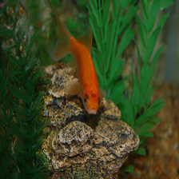
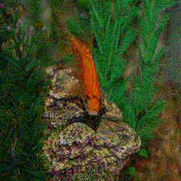
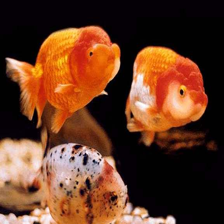

# V6 Multiple Proxy recovery report

Generated UTC: 2026-10-15 17:27:50

## Execution outcome

- Matrix: 13 unique ensembles × 5 forward transitions = 65 cells; 65 complete.
- Frozen attack images: 30 per transition; total expected target-evaluation rows: 1,950.
- Measured sum of attack gradient GPU time: 5.59 hours; total launcher wall time: 10.43 hours; peak recorded reserved VRAM: 49.14 GiB.
- Attack-optimization proxy forwards: 232,500; image-gradient backward passes: 232,500 (excludes post-freeze diagnostics, references, target inference and analysis).
- BF16 audit: 15/15 locked model checkpoints passed all-parameter BF16 and no-quantization checks.
- Validation errors: incomplete/missing cells=0, PNG L∞ violations=0.

All primary rates below are unconditional target targeted ASR over the 30 ground-truth-selected images. TASR is only shown as the legacy all-proxy-conditioned diagnostic, with its own denominator.

## Per-target ensemble comparison

| Target | Ensemble | Proxies | ASR (hits/150) | Clean-correct ASR | Legacy conditional TASR | mean ΔR | CKA | RSA | Runtime h |
|---|---|---:|---:|---:|---:|---:|---:|---:|---:|
| Gemma 4 31B-it | E04_Qwen3.5-2B | 1 | 0/150 (0.000) | 0/150 (0.000) | 0/138 (0.000) | 0.0047 | 0.5884 | 0.5056 | 0.05 |
| Gemma 4 31B-it | E05_Qwen3.5-2B_Qwen3.5-4B | 2 | 1/150 (0.007) | 1/150 (0.007) | 1/138 (0.007) | 0.0049 | 0.5913 | 0.5154 | 0.10 |
| Gemma 4 31B-it | E06_Qwen3.5-2B_Qwen3.5-4B_Qwen3.5-9B | 3 | 2/150 (0.013) | 2/150 (0.013) | 2/133 (0.015) | 0.0057 | 0.6094 | 0.5321 | 0.16 |
| InternVL3.5-14B-HF | E07_Gemma 4 E2B-it | 1 | 8/150 (0.053) | 8/142 (0.056) | 8/150 (0.053) | 0.0637 | 0.5451 | 0.5424 | 0.40 |
| InternVL3.5-14B-HF | E08_Gemma 4 E2B-it_Gemma 4 E4B-it | 2 | 13/150 (0.087) | 12/142 (0.085) | 13/150 (0.087) | 0.0642 | 0.5516 | 0.5460 | 0.82 |
| InternVL3.5-14B-HF | E09_Gemma 4 E2B-it_Gemma 4 E4B-it_Gemma 4 26B-A4B-it | 3 | 21/150 (0.140) | 20/142 (0.141) | 6/31 (0.194) | 0.0752 | 0.6117 | 0.5908 | 1.43 |
| Qwen3.5-27B | E01_InternVL3.5-2B-HF | 1 | 0/150 (0.000) | 0/150 (0.000) | 0/150 (0.000) | 0.0001 | 0.3221 | 0.3505 | 0.06 |
| Qwen3.5-27B | E02_InternVL3.5-2B-HF_InternVL3.5-4B-HF | 2 | 2/150 (0.013) | 2/150 (0.013) | 2/150 (0.013) | 0.0001 | 0.3856 | 0.4078 | 0.13 |
| Qwen3.5-27B | E03_InternVL3.5-2B-HF_InternVL3.5-4B-HF_InternVL3.5-8B-HF | 3 | 5/150 (0.033) | 5/150 (0.033) | 5/150 (0.033) | 0.0001 | 0.4444 | 0.4630 | 0.19 |
| Qwen3.5-27B | E10_InternVL3.5-2B-HF_Gemma 4 E2B-it | 2 | 4/150 (0.027) | 4/150 (0.027) | 4/149 (0.027) | 0.0001 | 0.4373 | 0.4275 | 0.46 |
| Qwen3.5-27B | E11_InternVL3.5-2B-HF_Gemma 4 E2B-it_CLIP ViT-L/14 | 3 | 10/150 (0.067) | 10/150 (0.067) | 7/37 (0.189) | 0.0001 | 0.5203 | 0.4943 | 0.52 |
| Qwen3.5-27B | E12_InternVL3.5-2B-HF_Gemma 4 E2B-it_CLIP ViT-L/14_SigLIP2-So400m-patch14-384 | 4 | 20/150 (0.133) | 20/150 (0.133) | 12/30 (0.400) | 0.0002 | 0.5583 | 0.5269 | 0.68 |
| Qwen3.5-27B | E13_InternVL3.5-2B-HF_Gemma 4 E2B-it_CLIP ViT-L/14_DINOv2-Large | 4 | 8/150 (0.053) | 8/150 (0.053) | 5/35 (0.143) | 0.0001 | 0.5580 | 0.5321 | 0.58 |

## Paired baseline and V7 gate

Gate decision: **do_not_trigger_v7** (2/3 target families clear the predeclared +5 percentage-point threshold).

| Target | Single-proxy baseline | Best multi-proxy | Baseline ASR | Best ASR | Paired gain (pp) | Paired bootstrap 95% interval (pp) |
|---|---|---|---:|---:|---:|---:|
| Gemma 4 31B-it | E04_Qwen3.5-2B | E06_Qwen3.5-2B_Qwen3.5-4B_Qwen3.5-9B | 0.000 | 0.013 | 1.33 | [0.00, 3.33] |
| InternVL3.5-14B-HF | E07_Gemma 4 E2B-it | E09_Gemma 4 E2B-it_Gemma 4 E4B-it_Gemma 4 26B-A4B-it | 0.053 | 0.140 | 8.67 | [4.67, 13.33] |
| Qwen3.5-27B | E01_InternVL3.5-2B-HF | E12_InternVL3.5-2B-HF_Gemma 4 E2B-it_CLIP ViT-L/14_SigLIP2-So400m-patch14-384 | 0.000 | 0.133 | 13.33 | [8.00, 18.67] |

## Composition, gradient compatibility, and compute

Pairwise gradient values are weighted by the number of image-step observations. Negative fraction is the share of pairwise cosine observations below zero. Singleton proxies have no pairwise value. ASR uses the same 150 frozen image instances for every ensemble within each target.

| Target | Ensemble | Proxies | ASR (hits/150) | Mean pair cosine | Negative fraction | CKA | RSA | Attack GPU h |
|---|---|---:|---:|---:|---:|---:|---:|---:|
| Qwen3.5-27B | E01_InternVL3.5-2B-HF | 1 | 0/150 (0.000) | N/A | N/A | 0.3221 | 0.3505 | 0.06 |
| Qwen3.5-27B | E02_InternVL3.5-2B-HF_InternVL3.5-4B-HF | 2 | 2/150 (0.013) | 0.0234 | 24.0% | 0.3856 | 0.4078 | 0.13 |
| Qwen3.5-27B | E03_InternVL3.5-2B-HF_InternVL3.5-4B-HF_InternVL3.5-8B-HF | 3 | 5/150 (0.033) | 0.0216 | 23.5% | 0.4444 | 0.4630 | 0.19 |
| Gemma 4 31B-it | E04_Qwen3.5-2B | 1 | 0/150 (0.000) | N/A | N/A | 0.5884 | 0.5056 | 0.05 |
| Gemma 4 31B-it | E05_Qwen3.5-2B_Qwen3.5-4B | 2 | 1/150 (0.007) | 0.0274 | 27.3% | 0.5913 | 0.5154 | 0.10 |
| Gemma 4 31B-it | E06_Qwen3.5-2B_Qwen3.5-4B_Qwen3.5-9B | 3 | 2/150 (0.013) | 0.0133 | 35.4% | 0.6094 | 0.5321 | 0.16 |
| InternVL3.5-14B-HF | E07_Gemma 4 E2B-it | 1 | 8/150 (0.053) | N/A | N/A | 0.5451 | 0.5424 | 0.40 |
| InternVL3.5-14B-HF | E08_Gemma 4 E2B-it_Gemma 4 E4B-it | 2 | 13/150 (0.087) | 1.0000 | 0.0% | 0.5516 | 0.5460 | 0.82 |
| InternVL3.5-14B-HF | E09_Gemma 4 E2B-it_Gemma 4 E4B-it_Gemma 4 26B-A4B-it | 3 | 21/150 (0.140) | 0.3360 | 25.6% | 0.6117 | 0.5908 | 1.43 |
| Qwen3.5-27B | E10_InternVL3.5-2B-HF_Gemma 4 E2B-it | 2 | 4/150 (0.027) | -0.0031 | 62.5% | 0.4373 | 0.4275 | 0.46 |
| Qwen3.5-27B | E11_InternVL3.5-2B-HF_Gemma 4 E2B-it_CLIP ViT-L/14 | 3 | 10/150 (0.067) | -0.0022 | 60.8% | 0.5203 | 0.4943 | 0.52 |
| Qwen3.5-27B | E12_InternVL3.5-2B-HF_Gemma 4 E2B-it_CLIP ViT-L/14_SigLIP2-So400m-patch14-384 | 4 | 20/150 (0.133) | -0.0018 | 58.7% | 0.5583 | 0.5269 | 0.68 |
| Qwen3.5-27B | E13_InternVL3.5-2B-HF_Gemma 4 E2B-it_CLIP ViT-L/14_DINOv2-Large | 4 | 8/150 (0.053) | -0.0038 | 64.7% | 0.5580 | 0.5321 | 0.58 |

## Interpretation

- Gemma 4 31B-it, Qwen same-family ladder: E04_Qwen3.5-2B to E06_Qwen3.5-2B_Qwen3.5-4B_Qwen3.5-9B changes pooled ASR from 0.0% to 1.3% (+1.3 percentage points); attack gradient time changes from 0.05 h to 0.16 h.
- InternVL3.5-14B-HF, Gemma same-family ladder: E07_Gemma 4 E2B-it to E09_Gemma 4 E2B-it_Gemma 4 E4B-it_Gemma 4 26B-A4B-it changes pooled ASR from 5.3% to 14.0% (+8.7 percentage points); attack gradient time changes from 0.40 h to 1.43 h.
- Qwen3.5-27B, InternVL same-family ladder: E01_InternVL3.5-2B-HF to E03_InternVL3.5-2B-HF_InternVL3.5-4B-HF_InternVL3.5-8B-HF changes pooled ASR from 0.0% to 3.3% (+3.3 percentage points); attack gradient time changes from 0.06 h to 0.19 h.
- Qwen3.5-27B heterogeneous block on the same 150 images: E10_InternVL3.5-2B-HF_Gemma 4 E2B-it: 2.7%, E11_InternVL3.5-2B-HF_Gemma 4 E2B-it_CLIP ViT-L/14: 6.7%, E12_InternVL3.5-2B-HF_Gemma 4 E2B-it_CLIP ViT-L/14_SigLIP2-So400m-patch14-384: 13.3%, E13_InternVL3.5-2B-HF_Gemma 4 E2B-it_CLIP ViT-L/14_DINOv2-Large: 5.3%. The SigLIP2-augmented E12 result is higher than E11; the DINOv2-augmented E13 result is lower than both. Adding proxies does not guarantee a gain.
- Gemma within-family pair versus adding 26B: mean pairwise gradient cosine / negative fraction are 1.0000 / 0.0% versus 0.3360 / 25.6%; pooled ASR is 8.7% versus 14.0%. This is descriptive post-hoc evidence, not a causal attribution.
- SigLIP2- versus DINOv2-augmented heterogeneous four-proxy ensembles: mean pairwise gradient cosine / negative fraction are -0.0018 / 58.7% versus -0.0038 / 64.7%; pooled ASR is 13.3% versus 5.3%. This is descriptive post-hoc evidence, not a causal attribution.
- Across the 65 cell-level rows, exploratory Spearman correlations with ASR are mean_CKA ρ=0.57, mean_RSA ρ=0.56, mean_DeltaR ρ=0.33, source_variance ρ=0.16, target_variance ρ=0.05, mean_target_clean_margin ρ=-0.29; cells share target and transition strata, so these associations are descriptive and not independent-sample causal estimates.
- Gradient redundancy/conflict is visible in pairwise cosine and negative fraction. The saved trace contains fused-gradient L2 summaries, but it does not retain each proxy gradient norm at every step; an exact normalized-gradient cancellation ratio therefore cannot be reconstructed from this run. CKA/RSA describe representation alignment and should not be treated as proof of gradient agreement or transfer causality.

## Successful frozen-PNG examples

Each row shows a clean input beside a target-successful adversarial PNG selected after the matrix was frozen. These are illustrative examples, not an extra evaluation sample.

| Target | Ensemble | Transition | Clean | Adversarial |
|---|---|---|---|---|
| Gemma 4 31B-it | E06_Qwen3.5-2B_Qwen3.5-4B_Qwen3.5-9B | T01 |  |  |
| InternVL3.5-14B-HF | E09_Gemma 4 E2B-it_Gemma 4 E4B-it_Gemma 4 26B-A4B-it | T01 |  |  |
| Qwen3.5-27B | E12_InternVL3.5-2B-HF_Gemma 4 E2B-it_CLIP ViT-L/14_SigLIP2-So400m-patch14-384 | T01 |  |  |

## Pinned models and representation taps

| Model | Exact checkpoint revision | Role | Visual depth | Deepest block |
|---|---|---|---:|---:|
| CLIP ViT-L/14 | `openai/clip-vit-large-patch14@32bd64288804d66eefd0ccbe215aa642df71cc41` | proxy | 24 | 23 |
| DINOv2-Large | `facebook/dinov2-large@47b73eefe95e8d44ec3623f8890bd894b6ea2d6c` | proxy | 24 | 23 |
| Gemma 4 26B-A4B-it | `google/gemma-4-26B-A4B-it@4d7ae4984b7db7de8f8457170b3f1a419ee76d52` | proxy | 27 | 26 |
| Gemma 4 31B-it | `google/gemma-4-31B-it@842da3794eaa0b77d5f08bae87a17459d91ff475` | target | 27 | 26 |
| Gemma 4 E2B-it | `google/gemma-4-E2B-it@3e22461f65e89153144f8adb70e3b8c2cc9845a7` | proxy | 16 | 15 |
| Gemma 4 E4B-it | `google/gemma-4-E4B-it@ee0ef6023621cff504d758262d4e04895a5af4a2` | proxy | 16 | 15 |
| InternVL3.5-14B-HF | `OpenGVLab/InternVL3_5-14B-HF@226b96d5912e69159abc0384cefcbd51487fdce0` | target | 24 | 23 |
| InternVL3.5-2B-HF | `OpenGVLab/InternVL3_5-2B-HF@3f301ffcf3dcbb47893afae6650ea3e78d96fb6d` | proxy | 24 | 23 |
| InternVL3.5-4B-HF | `OpenGVLab/InternVL3_5-4B-HF@6bd4487402110ef9889ba50eb7aefeb302526fed` | proxy | 24 | 23 |
| InternVL3.5-8B-HF | `OpenGVLab/InternVL3_5-8B-HF@741a7d03020411e666c6109218ab71e08151ef86` | proxy | 24 | 23 |
| Qwen3.5-27B | `Qwen/Qwen3.5-27B@fc05daec18b0a78c049392ed2e771dde82bdf654` | target | 27 | 26 |
| Qwen3.5-2B | `Qwen/Qwen3.5-2B@15852e8c16360a2fea060d615a32b45270f8a8fc` | proxy | 24 | 23 |
| Qwen3.5-4B | `Qwen/Qwen3.5-4B@851bf6e806efd8d0a36b00ddf55e13ccb7b8cd0a` | proxy | 24 | 23 |
| Qwen3.5-9B | `Qwen/Qwen3.5-9B@c202236235762e1c871ad0ccb60c8ee5ba337b9a` | proxy | 27 | 26 |
| SigLIP2-So400m-patch14-384 | `google/siglip2-so400m-patch14-384@e8e487298228002f3d8a82e0cd5c8ea9c567f57f` | proxy | 27 | 26 |

## Method and integrity

- Each proxy’s Pull/Push loss was computed only in that proxy’s own deepest visual-block representation, using its own 48-image reference prototypes and spatial-token mean pooling.
- Every proxy model was loaded with strict BF16 parameters, checked recursively before use, and run alone on the A100; the others remained BF16 on CPU. Per-image L1-normalized pixel gradients were equally averaged before momentum/sign updates.
- No target model, prediction, feature, or gradient was available in attack generation. Target generation and target representation analysis began after PNGs were frozen.
- Target clean-correct-conditioned ASR uses the target-clean-correct subset and is reported separately. Parse failures remain misses in unconditional ASR; zero conditional denominator is N/A.
- CKA and RSA compare target and proxy image representations on identical clean/adversarial image rows. Class dispersion uses 48 target reference embeddings/class. PCA/t-SNE are joint fits combining both classes, references, source clean images, and all ensemble adversarials for a given target/transition.
- This recovery includes only the five forward transitions. Reverse-source cohorts were not specified by the corrected recovery matrix, so directional asymmetry is explicitly marked not estimable here.

## Artifacts

- `multiple_proxy/summaries/multiple_proxy_recovery.csv` — cell summaries including ASR, TASR diagnostic, ΔR, CKA/RSA and runtime.
- `analysis/representation_shift/target_representation_shift.csv` — image-level target Δpull, Δpush, ΔR and margins.
- `analysis/proxy_representation_shift/` — image-level per-proxy embedding movements and margins.
- `analysis/gradient_compatibility/` — per-cell proxy gradient cosine/negative fraction.
- `analysis/variance/class_variance.csv`, `analysis/decision_geometry/decision_geometry.csv`, `analysis/cka/cka_rsa.csv`.
- `analysis/pca/`, `analysis/tsne/`, and `analysis/correlations/` — joint embeddings and Spearman heatmap.
- `audits/model_dtype_audit.json`, `audits/recovery_validation.json`, `audits/performance_benchmark.json`, `audits/v7_gate_decision.json`.
- `reports/multiple_proxy_recovery_completion.csv`, `reports/paired_ensemble_comparison.csv`.

- `analysis/proxy_representation_shift/proxy_representation_shift_summary.csv` — per-proxy movement means.
- `analysis/gradient_compatibility/gradient_compatibility_summary.csv` — observation-weighted pair summaries; detailed rows include batch indices.
- `analysis/gradient_compatibility/gradient_fusion_trace.csv` — per-batch fused-gradient L2 diagnostics.
- `reports/attack_examples.csv` and `examples/` — one deterministic clean/successful-adversarial pair for each target.
## Incomplete cells

None.
